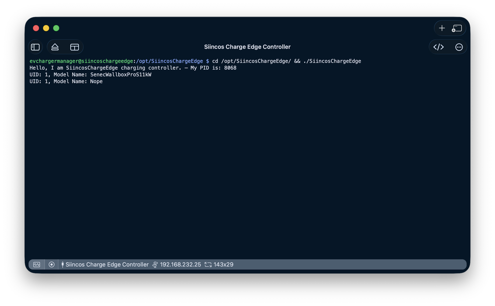

# Build and Install SiincosChargeEdge
Build and install SiincosChargeEdge from source, configure it for running.

## Prerequisites
Building from source and running the tests does not require physical devices, instead the binary is able to run with build-in mock devices. Definitely required is the following:
- Access to a ThingsBoard with tenant admin privileges
- The ThingsBoard server's (MQTT) server CA certificate. Using a non-TLS MQTT server is not possible!

### MQTT server CA certificate
* TODO

### Adding SiincosChargeEdge as a client device in ThingsBoard
* TODO

## Build from source
### Install Swift
* Follow the steps on: [https://www.swift.org/install/linux/](https://www.swift.org/install/linux/)
* When installing Swift on Raspberry Pi OS based on Debian 13 (trixie), the installer may warn you that no direct matching toolchain version could be found and that you should chose the closesd matching distro. I selected `Debian 12` and it seems to work.

### Prepare the Swift Toolchain
The project currently requires Swift 6.3 to build
1. Install Swift 6.3 toolchain: `swiftly install 6.3`
2. Activate toolchain: `swiftly use 6.3`
3. Double check: `swift --version`

### Prepare the Project
On the target (Raspberry, reComputer, etc.), run the following steps:
1. Make sure the path `/opt/SiincosChargeEdge` exists:
 * Create folder `sudo mkdir -p /opt/SiincosChargeEdge`
 * Change ownership to common user: `sudo chown evchargermanager:evchargermanager /opt/SiincosChargeEdge`
 * This is the install location (and is currently fixed)
2. Create the following directory layout:
 * `mkdir -p /opt/SiincosChargeEdge/Assets`
 * `mkdir -p /opt/SiincosChargeEdge/Logs`
3. Clone repo (e.g. into your home folder) and walk to the swift package folder: `git clone https://github.com/JoooHannesk/SiincosCharge.git && cd SiincosCharge/SiincosChargeEdge/`
4. Run `swift build` to check if everything builds correctly
5. Copy (and rename) the config file to the install location: `cp Assets/config.json.sample /opt/SiincosChargeEdge/Assets/config.json`
6. Add the MQTT (ThingsBoard) CA certificate: TODO
7. Edit the config file in place: TODO
8. Now run `swift test` to ensure all tests pass.
9. Run (as debug) to check everything works. At this point this should already be the case. Run `swift run SiincosChargeEdge` to execute the binary. Here you start *SiincosChargeEdge* for the first time and you should see the device appear as *online* in ThingsBoard. If you have connected physical devices to the RS485 bus, you will see its data appearing in ThingsBoard under the device's telemetry tab.
10. Build a standalone binary: `swift build -c release --product SiincosChargeEdge`. This is the *release* executable which is going to be *installed*.
11. Check the binary path and copy it to its destination (`swift build -c release --show-bin-path` is not building again, instead it is just showing where the binary is residing):
```bash
BIN_PATH=$(swift build -c release --show-bin-path)
cp ${BIN_PATH}/SiincosChargeEdge /opt/SiincosChargeEdge
```
12. You should be able to run the installed binary manually: `cd /opt/SiincosChargeEdge/ && ./SiincosChargeEdge`. Now, your terminal should look like this and the binary keeps running (is not killing itself):



You now have the *SiincosChargeEdge* executable in place. When you start it manually, your charging system is ready to take action. So make sure everything is configured according to your needs and is working properly before proceeding with the next steps. Make sure that:
* Connection to ThingsBoard is working, device appears as *online*
* The executable keeps running and is not *killing* itself
* No error messages appear in the logs `tail -f /opt/SiincosChargeEdge/Logs/****-**-**.log` when running `./SiincosChargeEdge`
* Your configuration uses a phyiscal charger and not the `MockCharger`
* You have physical devices connected (at least one charger) and you are able to control them via the ThingsBoard Dashboard

If that's the case, then: 🎉 **Congratulations, you have setup *SiincosChargeEdge* and configured it correctly!**

The next steps mainly focus on configuring the edge device's Linux system to run headless and standalone. This is recommended to enhance overall system stability and is required for a robust charging system.


## Install Binary
TODO


## Understanding the configuration file
* TODO
